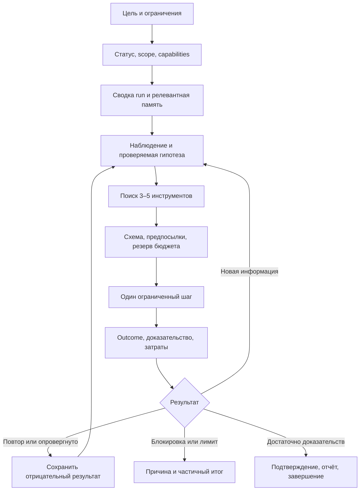

# MoonMCP: аудит инструментов, навигации и работы агента

Дата: 14 октября 2026. Проверенная версия: [`0aa2153`](https://github.com/Moonwuk/MoonMcp/tree/0aa2153b51b3ab1ce95dc9abcada17ff52322c38), main после PR #10. Это исследование и проект следующих изменений; производственный код в рамках отчёта не изменён.

Главный приоритет — сделать выбор, результат и продолжение вызова достоверными. В MoonMCP уже много возможностей: 213 инструментов, профили, поиск, память, граф, задачи, артефакты, подтверждение находок. Основной резерв эффективности находится в согласовании этих частей. Добавление ещё десятков детекторов увеличит объём каталога, но само по себе не исправит неверный выбор инструмента или потерянное состояние.

## 1. Что проверено

Инвентаризированы все 142 Python-файла пакета: 54 169 строк, включая большие справочники. В tests найдено 100 файлов `test_*.py` (102 Python-файла вместе со вспомогательными). Подробно проверены регистрация MCP/CLI, каталог и поиск, контекст, HTTP-клиент, память, runs, orchestration, telemetry, baseline, подтверждение результатов, pipeline, документация и CI. Инвентаризация всего дерева не означает построчную проверку всех детекторов или подтверждение их точности на реальных целях.

Проверки выполнялись локально на временных данных. Внешние цели не сканировались. Интернет использовался только для чтения открытой документации и обсуждений.

Воспроизводимые материалы: [инструкция и результаты](research/2026-10-14/README.md), [диагностика состояния и MCP](research/2026-10-14/reproduce.py), [эксперимент поиска](research/2026-10-14/measure_search.py), [реестр источников](research/2026-10-14/sources.json).

| Проверка | Результат |
| --- | --- |
| Ruff, текущий main | Успешно |
| Mypy | Успешно, 142 source files; часть модулей исключена через `ignore_errors` |
| Выборочные tests: search/catalog/profiles/runs/confirm/metrics | 46 passed |
| Baseline tests с остановкой на первом сбое | 1 failed: запись в `/home/agent/.moonmcp_baseline_runs` на read-only FS |
| Реальный MCP stdio-клиент, SDK 1.30.0 | 213 tools, `nextCursor=null`, 0 объявленных `outputSchema`; ошибочный вызов с `isError=false` |
| Изолированные воспроизведения | Подтверждены смешение целей в памяти, выпадение старых записей, сохранение curated при замене содержимого untrusted, изменение задачи другого run сценарием baseline |

Полный pytest в этой итерации не запускался. Успешные локальные проверки не означают успешный удалённый GitHub Actions.

## 2. Карта архитектуры и полезная существующая база

| Участок | Уже есть | Что мешает агенту |
| --- | --- | --- |
| `server.py`, `__main__.py` | MCP и CLI, gate-обёртки, единый AppContext | 7 515 строк в server.py; неоднородные результаты; ошибки не отражаются в MCP `isError` |
| `catalog.py`, `toolsearch.py` | Семейства, профили, короткие карточки кандидатов | Слабое ранжирование; описание доступности не учитывает runtime-зависимости |
| `scope.py`, `net/`, `auth.py` | Scope, проверка адреса, rate/concurrency governor, auth | Бюджеты run не встроены в фактическое исполнение |
| `runs.py`, `orchestration/`, `strix_adapted.py` | SQLite runs/tasks/events/artifacts; отдельный граф агентов | Несколько источников состояния; нет атомарного claim/lease задачи |
| `memory.py`, `findings.py` | FTS5, trust/provenance, граф сущностей, dedup | Изоляция target, версия доверенного содержимого, полное восстановление findings |
| `web/`, `recon/`, `intel/`, `data/` | Много специализированных проверок и справочников | Необходим единый контракт предпосылок, доказательств и ограничений |
| `pipeline.py`, `external/` | Внешние CLI и локальные KB | KB привязаны к домашним каталогам; установленность инструмента не означает готовность данных |
| `telemetry/`, `metrics.py`, `bench.py` | Метрики precision, timeline, сценарии baseline | Сборщик telemetry не подключён к основным событиям; baseline не проверяет ряд заявленных исходов |
| CI, packaging | Python 3.10–3.12, lint/type/coverage, сборка и установка wheel | Smoke `--check` не проверяет настоящий MCP-вызов и его семантику |

Сохранять существующие сильные стороны: проверки scope на сетевой границе, лимиты, разделение lead/confirmed, provenance, артефакты с хешем, отказ неизвестного профиля, stdlib-first подход. `tool_search`, baseline и fail-closed профили **уже реализованы** в PR #8–10. Ранний [план навигации](AGENT_NAVIGATION_PLAN.md) нужно читать с этой поправкой.

## 3. Обнаруженные проблемы

### A. Память смешивает цели и теряет релевантную историю — высокий приоритет

Источник: [`memory.py:349`](https://github.com/Moonwuk/MoonMcp/blob/0aa2153b51b3ab1ce95dc9abcada17ff52322c38/moonmcp/memory.py#L349).

`brief()` ищет target как подстроку. Поэтому запись `https://notexample.com/a` попадает в `brief("example.com")`. Дополнительно `brief()` берёт `search("", limit=400)`, но search ограничивает limit до 200. После добавления 205 более новых записей другого target старая нужная finding исчезает из сводки, хотя остаётся в БД. Это воспроизведено.

В `search()`, `entities()` и `graph()` часть фильтрации выполняется после LIMIT. Если большая часть первых строк относится к другим целям, результат может быть неполным. Для общего `search` это отдельное наблюдение по коду, не отдельный замер.

**Изменение:** хранить нормализованный `target_host`/project ID, фильтровать SQL-запрос до LIMIT, использовать разобранный hostname. Поддомены включать только по явному правилу проекта, а не по произвольному вхождению строки. Сохранять original URL. Для миграции добавить индекс и backfill. Проверки: разные домены, поддомены, URL с портом/путём, IDNA и большой объём нерелевантной истории.

### B. Новое untrusted-содержимое наследует метку curated — высокий приоритет

Источник: [`memory.py:129`](https://github.com/Moonwuk/MoonMcp/blob/0aa2153b51b3ab1ce95dc9abcada17ff52322c38/moonmcp/memory.py#L129), [`agents.py:159`](https://github.com/Moonwuk/MoonMcp/blob/0aa2153b51b3ab1ce95dc9abcada17ff52322c38/moonmcp/orchestration/agents.py#L159).

Upsert с одинаковыми kind/target/title заменяет body/source/provenance, но сохраняет `trust='curated'` старой записи. Воспроизведение: curated `reviewed content` → untrusted `unreviewed replacement`; итоговое содержимое новое, метка curated прежняя. `BaseAgent.share()` дополнительно использует curated по умолчанию.

**Изменение:** доверие привязать к конкретной версии содержимого. Untrusted update сохранять новой версией/наблюдением; прежняя vetted-версия остаётся доступной. Явное подтверждение переводит определённый content hash в curated. Наблюдения агента по умолчанию untrusted/inferred. Аналогичную политику применить к attrs сущностей. Это исправление целостности знаний, а не повод подключать отдельную векторную БД.

### C. Ошибка инструмента выглядит успешным MCP-вызовом — высокий приоритет

Источник: [`server.py:190`](https://github.com/Moonwuk/MoonMcp/blob/0aa2153b51b3ab1ce95dc9abcada17ff52322c38/moonmcp/server.py#L190), [`__main__.py:63`](https://github.com/Moonwuk/MoonMcp/blob/0aa2153b51b3ab1ce95dc9abcada17ff52322c38/moonmcp/__main__.py#L63).

`safe_tool` возвращает обычный dict с `error`. В проверке через stdio вызов `run_status` с несуществующим ID дал `invalid_input` внутри text content и `isError=false`. На текущем SDK ни один из 213 tools не объявляет outputSchema. Это не нарушение протокола само по себе: outputSchema необязательна. Но клиент вынужден разбирать текст и угадывать семантику. CLI после успешного Python-вызова тоже возвращает 0, даже если результат содержит прикладную ошибку; последнее подтверждено чтением кода.

**Изменение:** общий внутренний outcome и отдельные адаптеры MCP/CLI. Для ошибки выполнения MCP передаёт `CallToolResult(isError=True)`, CLI — ненулевой exit status. Прикладной verdict `unconfirmed` остаётся корректным результатом, а не ошибкой исполнения. Различать `out_of_scope`, `disabled`, `missing_dependency`, `invalid_input`, `rate_limited`, `budget_exhausted`, `timeout`, `internal_error`; указывать retryability и способ восстановления. Не менять молча форму всех 213 legacy-ответов: сначала адаптер, затем версионированные типизированные ответы.

### D. Baseline может портить состояние и неверно оценивать результат — высокий приоритет

Источник: [`bench.py`](https://github.com/Moonwuk/MoonMcp/blob/0aa2153b51b3ab1ce95dc9abcada17ff52322c38/moonmcp/bench.py).

Подтверждены три случая:

1. `scenario_run_continuation()` меняет **task_id=1**, а не ID задачи созданного run. При заранее созданном run его первая задача меняется pending → running.
2. `scenario_budget_exhausted()` ждёт Python exception, но `safe_tool` превращает отказ в dict. Сценарий пишет `UNEXPECTED: budget not enforced`, хотя отдельная проверка показывает корректный `invalid_input` из `run_usage`.
3. Сценарий создаёт каталог под `Path.home()` независимо от заданного state dir и падает в текущей облачной среде.

Дополнительные ограничения по коду: `graphql_check` и `analyze_js` обращаются к сетевому пути, несмотря на обещание offline; `.test` не является фикстурой, отключающей DNS/HTTP. «Продолжение» не перезапускает процесс. «Нет браузера» не вызывает browser_open. Auth-сценарий использует XSS-справочник как заменитель. Harness считает вызовы, но не проверяет их содержательные исходы. Выбранные вручную schema slices не являются измерением реально загруженного контекста клиента.

**Изменение:** временный AppContext до первого вызова; IDs только из результатов; network-deny по умолчанию и явный fixture transport; outcome assertions. Restart-сценарий — два процесса с общей временной БД. Никакого доступа к пользовательскому store. Успех сценария зависит от корректного состояния/вывода, а стоимость считается отдельно.

### E. Поиск недостаточно релевантен и не многоязычен

Источник: [`toolsearch.py:65`](https://github.com/Moonwuk/MoonMcp/blob/0aa2153b51b3ab1ce95dc9abcada17ff52322c38/moonmcp/toolsearch.py#L65).

Измерено при limit=5, без phase:

| Запрос | Наблюдение |
| --- | --- |
| `scope` | В top-5 нет ни одного `scope_*` |
| `sqli` | `sqli_probe` отсутствует в выдаче |
| `run budget` | В top-5 нет `run_usage`/`run_status` |
| `sql injection` | `sqli_probe` находится на 4-й позиции |
| `проверить авторизацию`, `身份验证`, `인증 검사`, `verificar autorização` | Пустые результаты |

Причины: ASCII-токенизация, underscore остаётся внутри слова, поиск по короткой первой фразе описания, одинаковый вес общеупотребительных слов, алфавитное разрешение ничьих. `available_only` проверяет hidden, но `_live_meta` всегда выставляет hidden=False: профиль уже применён, доступность Playwright, CLI, KB, auth и конфигурации не проверяется.

Локальный эксперимент с Unicode и разбиением snake_case возвращает `sqli_probe` в top-5 и улучшает `scope`, **но** вытесняет `sqli_probe` из top-5 для `sql injection`; `run budget` всё ещё не находит нужное действие. Поэтому этот эксперимент не следует выпускать как законченную оптимизацию. Результаты сохранены, производственный токенизатор не менялся.

**Изменение:** единый ToolSpec, exact-name boost, компоненты идентификаторов, словарь предметных синонимов, BM25 по purpose/keywords/preconditions с ослаблением общих слов. Добавить различение intent: «посмотреть scope» и «изменить scope». Unicode сам по себе не переводит запросы; для RU/ZH/KO/PT/HI нужны проверенные aliases либо необязательный multilingual retriever. Embeddings/reranker подключать только после сравнения с простым локальным baseline. Кэш индекса инвалидировать по версии registry/profile/capabilities.

### F. Бюджеты и наблюдаемость не образуют единый контур исполнения

Источник: [`context.py:98`](https://github.com/Moonwuk/MoonMcp/blob/0aa2153b51b3ab1ce95dc9abcada17ff52322c38/moonmcp/context.py#L98), [`runs.py:301`](https://github.com/Moonwuk/MoonMcp/blob/0aa2153b51b3ab1ce95dc9abcada17ff52322c38/moonmcp/runs.py#L301), [`net/http.py:472`](https://github.com/Moonwuk/MoonMcp/blob/0aa2153b51b3ab1ce95dc9abcada17ff52322c38/moonmcp/net/http.py#L472).

Это архитектурные наблюдения, а не проведённый нагрузочный тест. `run_usage` атомарно защищает счётчик, но вызывается вручную; обычный вызов инструмента не связан с run/task и не списывает реальную стоимость автоматически. AppContext создаёт TelemetryCollector, однако поиск вызовов его `record_request/record_finding/record_agent_status` не обнаружил подключения к основным путям работы. Одноимённый вызов в HttpClient относится к OpsecEngine и не наполняет этот collector.

**Изменение:** общий execution context `{run_id, task_id, invocation_id, attempt_id}`, проверка состояния и резервирование до действия, фактический учёт каждого сетевого отправления, исход и артефакты после действия. Для браузера/внешнего CLI честно различать измеренные и оценочные расходы. В telemetry отправлять события из той же границы. Отдельно считать логические вызовы и попытки: ретрай с сетевым запросом тоже расходует request budget, даже если результат ошибочный.

### G. Возобновление и несколько исполнителей требуют явного контракта

Источник: [`runs.py:258`](https://github.com/Moonwuk/MoonMcp/blob/0aa2153b51b3ab1ce95dc9abcada17ff52322c38/moonmcp/runs.py#L258), [`orchestration/agents.py`](https://github.com/Moonwuk/MoonMcp/blob/0aa2153b51b3ab1ce95dc9abcada17ff52322c38/moonmcp/orchestration/agents.py), [`findings.py`](https://github.com/Moonwuk/MoonMcp/blob/0aa2153b51b3ab1ce95dc9abcada17ff52322c38/moonmcp/findings.py).

`next_task` только читает pending-задачу; два workers могут выбрать одну и ту же. В orchestration встречаются catch-and-continue и итоговый `success=True` даже после ошибок дочерних действий. FindingsStore в AppContext создаётся в памяти; зеркало в memory не восстанавливает автоматически прежний список findings с исходными ID. AgentGraph и SQLite runs имеют отдельное состояние остановки/задач.

**Изменение:** RunStore — источник истины для задач, граф — представление. Claim с транзакцией, owner, lease, heartbeat и attempt ID. Стабильные IDs findings/artifacts, восстановление в новом процессе. При timeout после возможного побочного эффекта статус `unknown`, затем сверка; автоматическое повторение допускается только с доказанной идемпотентностью. Lease не обеспечивает exactly-once внешних действий. Правила completion должны сохранять failed/blocked/partial и их причины, а не приравнивать завершение к полному обследованию.

## 4. Предлагаемая навигация агента



Практические правила:

- Сначала ориентироваться и восстановить контекст; полный каталог не перечитывать на каждом шаге.
- Выбирать минимальное действие под наблюдение. Composite `recon_target` не запускать повторно после выполнения всех его актуальных компонентов.
- В результатах держать короткую сводку, статус, ограничения, evidence refs и максимум несколько следующих предложений. Большие тела — артефактом/resource link с пагинацией.
- Кэшировать подходящие чтения по run/project, нормализованному target, args, версии инструмента, scope version и auth-context ID без секретов. Не смешивать роли и проекты. TTL и причины инвалидирования обязательны.
- Независимые чтения можно выполнять параллельно в общем governor. Shared browser/auth session и изменяющие состояние действия требуют координации. Само увеличение concurrency не является критерием улучшения.
- У каждой остановки должна быть понятная причина: недостаточно данных, нет зависимости, исчерпан бюджет, нет прогресса, подтверждено, опровергнуто. Неуспешный неизменённый вызов не повторять бесконечно.

### ToolSpec и результат

Реестр должен описывать: stable name/version, purpose и aliases, семейство/phase, тип I/O, inputs/outputs, dependencies, auth requirements, scope/intrusive markers, стоимость/лимиты, read-only/idempotency hints, cache policy, примеры и условия применимости. Маркеры фактических обёрток остаются проверяемым источником ограничений; описания не дают разрешения на действие.

Результат новой версии: `status`, `summary`, `observations`, `limitations`, `evidence_refs`, `cost`, `next_candidates`, `error`. Доказательства содержат источник, время, контекст и хеш, а не только итоговую уверенность. Значения blocked/partial/unknown должны быть отличимы от отсутствия находок.

Нужно различать три операции: найти подходящий tool, узнать его реальную доступность, получить полную схему для вызова. Отсутствующая зависимость возвращается с причиной и альтернативой; скрытый профилем инструмент не становится вызываемым через общий dispatcher.

### Реальное сокращение контекста

Сейчас сериализация массива `{name, description, inputSchema}` занимает **178 070 UTF-8 байт**, примерно 174 KiB. Это размер выбранного JSON-представления, не число токенов LLM и не замер контекста конкретного клиента. Профили уменьшают количество tools: full 213, strix 137, passive 87, knowledge 34, recon 122.

Сравнить три режима: существующие typed tools со статическим профилем; поддерживаемая host/client динамическая загрузка; необязательный compact facade (`search`, `describe`, `execute`, `artifact_read`, `run_brief`). Последний — эксперимент, а не обязательная замена MCP API. Он уменьшает стартовую поверхность, но может ухудшить качество аргументов, добавить вызовы и скрыть сведения, используемые UI клиента.

`execute` обязан вызывать тот же зарегистрированный gated callable, проверять схему и доступность, сохранять audit/бюджеты и не открывать hidden tools. `describe` не должен раскрывать секреты. Для старых клиентов оставить прямые typed tools. Встроенное исполнение произвольного кода для этой задачи не требуется.

## 5. Анализ и предложение идей

Существующие `variant_search`, knowledge tools и `.claude/skills/idea-gen` дают полезную основу: наблюдение → root cause/CWE → возможные проверки → подтверждение. `variant_search` использует эвристические keyword maps. `think_structure` в strix_adapted разбирает текст на секции и возвращает timestamp; он сам не генерирует идеи, не проверяет факты и не сохраняет полноценную историю гипотез.

Предлагаемый объект гипотезы:

```json
{
  "id": "h-17",
  "run_id": "...",
  "claim": "Наблюдение объясняется различием ролей",
  "evidence_refs": ["artifact:..."],
  "alternatives": ["устаревший кэш", "разные входные данные"],
  "preconditions": ["две разрешённые тестовые роли"],
  "distinguishing_check": "сравнить согласованную контрольную пару",
  "expected_observation": "воспроизводимая разница при фиксированных данных",
  "estimated_cost": {"requests": 2},
  "status": "proposed"
}
```

Хранить факты, ссылки, краткое обоснование и проверяемые ожидания. Запись скрытой цепочки размышлений модели не нужна. Генерация формулировок выполняется агентом/моделью; MCP хранит контракты, ищет знания, предлагает применимые семейства и обеспечивает проверку.

Ранжировать гипотезы по подтверждённой применимости, ожидаемой полезной информации и стоимости. Impact и новизна полезны как дополнительные признаки, но красивый score не заменяет evidence. Если вероятности не калиброваны, показывать порядковую оценку и её основания, не псевдоточные проценты.

Нужны отрицательные результаты и условия повторной проверки. Например, `falsified` хранит контроль, версию сервиса/контекста и причину; новая версия или роль может открыть гипотезу снова. Это уменьшает повторы и помогает отличать новую идею от переформулировки старой.

У `confirm.evaluate()` уже есть ограничения для слабых сигналов и differential oracle. Следующий шаг — калибровка на положительных/отрицательных fixtures по классу, независимые контроли и прослеживаемость OAST-корреляции. По одному чтению функции нельзя утверждать её реальную precision.

Полезные дополнения к MCP, после исправлений: `run_brief` (сводка состояния), capability details в `server_status`, `tool_describe` при compact-режиме, хранение/список/обновление гипотез, чтение артефакта частями. Сначала расширить существующие run/memory API там, где это не создаёт неоднозначный action-dispatcher; не добавлять новый tool для каждой мелкой операции.

## 6. Исследования и технические решения

Ниже — реально прочитанные первичные README/документы и GitHub issues. README описывает возможности авторов; это не независимое подтверждение скорости или качества. Полные PDF статей не были доступны через текущую сеть; научные методы изучены по сопровождающим репозиториям. Зафиксированные копии и SHA-256 перечислены в sources.json.

| Источник | Что применимо к MoonMCP | Ограничение вывода |
| --- | --- | --- |
| [MCP tools specification 2025-06-18](https://github.com/modelcontextprotocol/modelcontextprotocol/blob/main/docs/specification/2025-06-18/server/tools.mdx) | `isError`, structuredContent/outputSchema, resource links, pagination | Это проверенная версия спецификации; не заявление, что она последняя на дату аудита |
| [ToolLLM / ToolBench](https://github.com/OpenBMB/ToolBench) | Разделение retrieval, выбора/планирования и выполнения; оценка маршрутов, а не только JSON | Результаты другого набора API не переносим на security tools |
| [StableToolBench](https://github.com/zhichengg/StableToolBench) | Стабильные ответы/fixtures и проверка решаемости задач до сравнения агентов | Их LLM simulator не нужен для детерминированных core-тестов MoonMCP |
| [Berkeley Function Calling Leaderboard](https://github.com/ShishirPatil/gorilla/tree/main/berkeley-function-call-leaderboard) | Оценивать argument correctness, multiple/parallel calls, multi-turn и memory отдельно | Лидерборд модели не измеряет качество нашего registry/HTTP/state |
| [τ-bench, актуальный репозиторий tau2-bench](https://github.com/sierra-research/tau2-bench) | Конечное состояние, policy, повторные прогоны, корректные задания | README уже описывает τ³ и исправления grading; версии результатов нужно фиксировать |
| [ToolUniverse compact mode](https://github.com/mims-harvard/ToolUniverse/blob/main/docs/guide/building_ai_scientists/compact_mode.rst) | Малый фасад list/search/describe/execute, извлечение только нужных схем | Заявленные авторами проценты экономии не являются замером MoonMCP |
| [Composio](https://github.com/ComposioHQ/composio) | Runtime discovery, привязка инструментов/auth к пользовательской сессии, сохранение session ID | SaaS-архитектура не требует переноса MoonMCP в облако |
| [mcp-agent](https://github.com/lastmile-ai/mcp-agent) | Композиция router/parallel/evaluator, lifecycle и tracing | Не требует добавления всего framework в зависимости |
| [LangGraph](https://github.com/langchain-ai/langgraph), [обсуждение #9185](https://github.com/langchain-ai/langgraph/issues/9185) | Checkpoints и повторное исполнение: idempotency key, reconciliation после неоднозначного timeout | Сообщение сообщества с примером; внешнее воспроизведение нами не запускалось |
| [Qwen-Agent 中文](https://github.com/QwenLM/Qwen-Agent/blob/main/README_CN.md), [#980](https://github.com/QwenLM/Qwen-Agent/issues/980), [#992](https://github.com/QwenLM/Qwen-Agent/issues/992) | Tool calling/MCP, полнота discovery по nextCursor, корреляция параллельных аргументов по call ID/index | MoonMCP сейчас отдаёт одну страницу; пагинационный дефект клиента здесь не воспроизведён |
| [AgentScope 中文](https://github.com/agentscope-ai/agentscope/blob/main/README_zh.md) | Dynamic tool management, выгрузка больших результатов, events, interrupt/resume | Технический источник китайского проекта; не измерение нашей производительности |
| [LangChain Korean tutorials](https://github.com/teddylee777/langchain-kr), [OpenTutorial](https://github.com/LangChain-OpenTutorial/LangChain-OpenTutorial) | Корейские учебные маршруты по agent/tools/retrieval; сценарные примеры для документации | Учебные материалы не заменяют нагрузочную/сравнительную оценку |
| [Agno](https://github.com/agno-agi/agno), [#11014](https://github.com/agno-agi/agno/issues/11014) | Сохранность связки tool_call → result при pause/resume и структурировании финального ответа | Issue открыт на момент чтения; это reported case, не независимо подтверждённый нами дефект |
| [CrewAI](https://github.com/crewAIInc/crewAI) | Различать автономную роль и детерминированный workflow/Flow | Много агентов само по себе не гарантирует качество |
| [SAEP 2026, Unisinos, португальский оригинал](https://github.com/armandokeller/SAEP2026-Agentes-IA-e-Ferramentas) | Проверка окружения без модели, постепенное построение tool loop/MCP, fixtures с отсутствующими фактами | Практический бразильский учебный материал, не benchmark |
| [Conta Azul MCP, португальский оригинал](https://github.com/douglac/contaazul-mcp) | Различать discovery, authentication, подключение ресурса и готовность вызова; явный onboarding | Прикладной ERP-пример; его prompt и действия авторизации не исполнялись |
| [Tapetide NSE/BSE MCP](https://github.com/Tapetide-hq/nse-bse-indian-stock-market-data-mcp) | Для индийского рынка: ограниченные batch-tools, сверка каталога, rate-limit result с `isError=true` и retry delay | Читалась документация, удалённый сервис и заявленные квоты не проверялись |
| [IndianKanoon connector](https://github.com/rohankgeorge/indiankanoon-mcp-connector) | Для индийского права: явные spend/call caps и описание сброса при рестарте | Их in-memory cap нельзя использовать как образец устойчивого бюджета run |

Дополнительно прочитаны переводы Microsoft AI Agents for Beginners: [pt-BR](https://github.com/microsoft/ai-agents-for-beginners/tree/main/translations/pt-BR/04-tool-use), [ko](https://github.com/microsoft/ai-agents-for-beginners/tree/main/translations/ko/04-tool-use), [hi](https://github.com/microsoft/ai-agents-for-beginners/tree/main/translations/hi/04-tool-use). Это переводы одного курса, а не три независимых исследования.

Географический охват неоднороден: англоязычные исследовательские/инженерные источники, в том числе Berkeley/Harvard; китайские оригиналы; корейские материалы; бразильские оригиналы; прикладные проекты для Индии и перевод на хинди. Национальность автора не выводилась из имени. Форумная часть — прочитанные GitHub issues с кодом воспроизведения и комментариями.

Прямой доступ к Google/arXiv и ряду региональных сайтов ограничен сетевой политикой облачной среды. Поэтому это не полный обзор Zhihu/Juejin, Velog/Disquiet, Analytics Vidhya или TabNews. Для продолжения такого поиска подготовлен черновик allowlist среды; его нужно применить в настройках. Эти площадки не перечисляются как прочитанные источники.

## 7. Как доказать улучшение

Сначала исправить oracle baseline; сравнение на неправильном oracle закрепит ошибки. Разделить evaluation на четыре слоя:

| Слой | Набор | Метрики |
| --- | --- | --- |
| Retrieval | 60–100 размеченных намерений, несколько допустимых tools, отсутствующие зависимости, разные профили; отдельные RU/EN/ZH/KO/PT/HI с языковой проверкой | Recall@5, MRR, unavailable recommendation rate, wrong-intent rate; результаты по языкам, без смешивания в один средний балл |
| Protocol | Настоящие stdio initialize/list/call; ошибки, timeout, cancellation, большие результаты, при добавлении pagination — все страницы | Корректность схем/флагов/ID, отсутствие lost/duplicate responses, полнота discovery |
| Workflow | 7 исходных сценариев после исправления плюс restart, две auth-роли, отрицательный результат, stale dependency, partial failure | Task success, состояние store, покрытие, лишние вызовы, сохранность evidence, число реальных fixture requests |
| Agent/host | Один и тот же pinned model/config на одинаковых fixtures; несколько seeds/trials | Success и variance, фактические input/output tokens, p50/p95 latency, cost на успешно решённую задачу |

Правила сравнения: held-out набор не использовать для ручной подгонки aliases; неизвестное намерение может корректно не иметь кандидата; пустые/неуспешные ответы не засчитывать как экономию. В report фиксировать версии fixture, tool registry, SDK, модели и клиента. Проверки локальной логики не требуют платной модели в CI; model-evals запускать отдельно по заданному лимиту.

Стартовые критерии, **ещё не достигнутые показатели**: исправлены все воспроизведения A–D; retrieval Recall@5 ≥90% на согласованном наборе; ни одного вызова недоступного/скрытого инструмента через facade; снижение контекста/повторов на 30% при сопоставимом task success и покрытии. После первого валидного baseline уточнить пороги и допустимую погрешность. Ни метрики текущей токенизации, ни эксперимент на 12 запросах не доказывают эти цели.

## 8. Порядок реализации отдельными PR

| PR | Содержание | Приёмка и зависимости |
| --- | --- | --- |
| 1 | Исправить baseline: временные stores, реальные ID, outcome checks, offline fixtures, настоящий restart | Не меняет пользовательские runs; проходит с read-only home и без внешней сети |
| 2 | Memory integrity: target normalization/SQL filtering, версии trust, безопасный default share | Все воспроизведения памяти исправлены; миграция не теряет прежние записи; тесты большого нерелевантного хвоста |
| 3 | MCP/CLI error adapter, типизированные outcomes и stdio smoke из wheel | Ошибка → `isError=true`/exit≠0; `unconfirmed` остаётся успешным выполнением; совместимость legacy |
| 4 | ToolSpec/capabilities и retrieval v2 с независимым набором запросов | Привязка к live registry, отсутствие hidden tools, понятные причины недоступности, замер качества; после PR 1 |
| 5 | Execution context, автоматические бюджеты, telemetry, отмена | Без ручного `run_usage` лимит не обходится; конкуренция/ретраи учтены; после PR 3 |
| 6 | Persisted findings, run_brief, claim/lease, reconciliation | Новый процесс продолжает run; два workers не получают один claim; timeout не провоцирует слепой повтор; после PR 2/5 |
| 7 | Evidence summaries/resources, bounded cache и compact facade experiment | Замер реального клиента; изоляция auth/project; сохранение gates/профилей; после PR 3–5 |
| 8 | Hypothesis workflow и оценка качества идей | Evidence-backed hypotheses, negative-result memory, калибровка подтверждений; после PR 1/2/6 |

После появления измерений: профилировать повторное построение FTS при открытии MemoryStore и создание HTTP opener на каждый запрос. Внедрение pooling требует сохранения DNS pinning, auth isolation, proxy/redirect semantics и cancellation; автоматически заменять HTTP-бэкенд ради предполагаемой скорости не следует. Разделение server.py на семейства/адаптеры выполнять при сохранении публичных имён и контрактов. Новая orchestration framework, GPU retriever или замена SQLite сейчас не обоснованы измерениями.

Первый полезный выпуск — корректные baseline/память/ошибки плюс измеримо лучший поиск. Автономный loop и параллельные workers строятся поверх устойчивого исполнения и восстановления.
