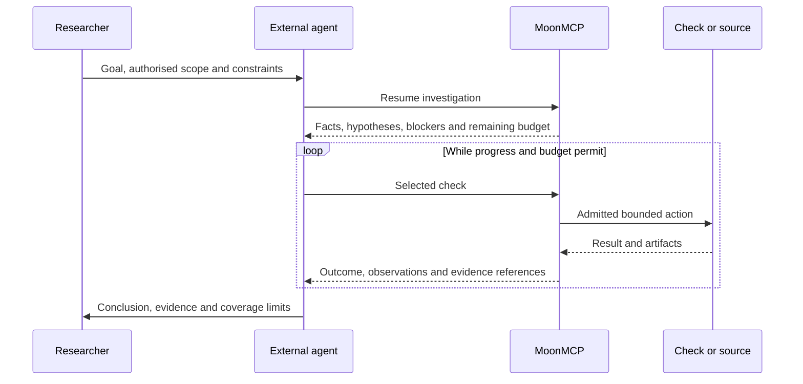

# MoonMCP research harness: positioning and delivery roadmap

**Reviewed:** 2026-10-21. **Implementation baseline:**
[`6f33522`](https://github.com/Moonwuk/MoonMcp/commit/6f33522e7f649f0c942619fe27c59ec09f30f925),
after [PR #26](https://github.com/Moonwuk/MoonMcp/pull/26).
**Delivery:** documentation and positioning. All runtime changes and experiments
below are proposed; this document records no new performance measurement.

## Product definition

**MoonMCP is a stateful security-research harness exposed through MCP.** It gives
AI agents and human operators a shared environment for authorised reconnaissance,
resumable assessments, evidence collection and bounded verification.

In Russian: **MoonMCP — среда исполнения и проверки исследований безопасности
для ИИ-агентов: сохраняет состояние исследования, выполняет разрешённые проверки,
связывает выводы с доказательствами и поддерживает воспроизведение через MCP.**

The external agent currently owns model calls, hypothesis selection and research
strategy. MoonMCP owns its domain records and supported execution paths. An
independent human review remains required before a finding is treated as ready
for external disclosure. A server response, a hash or a delegate's confidence
does not replace that review.

The term *research harness* describes this domain responsibility. A complete
agent runtime would additionally own the model/tool loop, model-context assembly
and provider usage. That broader runtime is optional future work, not a delivered
MoonMCP capability. MCP provides the integration interface; it does not itself
provide research strategy, durable investigations or discovery effectiveness.
See the [MCP architecture][mcp] and [agent/evaluation terminology][evals].

The product question is: **does an agent reach more independently reviewable
security conclusions with MoonMCP, under comparable access and budgets?**
Tool counts, generated hypotheses and a passing infrastructure suite are useful
diagnostics, but do not answer that question.

## What exists at the baseline

The [implementation status](ROADMAP_STATUS_2026-10-21.md) remains the dated map
of delivered portions and open acceptance requirements. The table below selects
the parts relevant to this positioning; it is not a new implementation audit.

| Responsibility | Existing foundation | Boundary or remaining work |
| --- | --- | --- |
| Investigation lifecycle | Persistent runs, tasks, dependencies, claims, leases, heartbeats and finish/recovery operations | Task role names do not instantiate autonomous model workers. |
| Supported execution | Registered gated callables, `run_execute`, schema checks, receipts, target/context binding and actual HTTP-send reservations | Direct calls do not automatically join a run budget. Browser/raw/CLI paths remain excluded from managed dispatch unless their real accounting is supported. |
| Research state | Flags, hypotheses, findings, memory, `run_brief`, `analysis_brief` and immutable run artifacts | The external agent interprets evidence and chooses hypotheses. A generic investigator/librarian loop is absent. |
| Agent interface | `tool_search`, `tool_describe`, logical profiles, compact exposure and bounded previews with full artifact retrieval | Compact catalog bytes are not measured model-token savings or task-quality gains. Host behavior matters. |
| Verification | Selected private-object read proof with explicit identities/policy/controls and two trusted HTTP/SQLite replay recipes | No universal proof engine, general write/integrity proof or arbitrary-project preparation is established. |
| Evaluation | Independent deterministic comparison of heuristic and semantic private-read workflows on 16 synthetic cases | No LLM is called; candidate inputs already supply target, authentication and proof parameters. This does not measure discovery from an initial research task. |

Implementation references: [run store](../moonmcp/runs.py),
[managed execution](../moonmcp/execution.py), [agent tools](../moonmcp/agent_tools.py),
[operating workflow](AGENT_WORKFLOW.md), [proof limits](VERIFIED_AUTHORIZATION.md),
[replay limits](RESEARCH_REPLAY.md) and [evaluator](../moonmcp/evaluation.py).
The existing [orchestration classes](../moonmcp/orchestration/agents.py) coordinate
injected callbacks; their names do not establish a general model-driven loop.

## Architecture and ownership

The following is the intended primary workflow using existing primitives.
The external agent selects the next test. Proposed improvements to continuation,
session handling and evaluation are identified in the delivery roadmap below.

| Component | Owns | Must not assume |
| --- | --- | --- |
| Researcher | Goal, authorisation, supplied policy/identities, final finding review | An automated claim is already disclosure-ready. |
| External host/agent | Model calls, context assembly, strategy and user interaction | MCP connectivity makes every operation managed or every result true. |
| MoonMCP domain core | Run/task state, evidence, hypothesis history, supported execution and recovery | It controls tools or network traffic invoked outside its supported paths. |
| MCP/CLI interfaces | Discovery and access to registered capabilities | A different interface grants additional scope or restores lost credentials. |
| Optional check/source/delegate | A declared operation and evidence under its own supported contract | Initial target admission controls all downstream traffic or provider costs. |
| Evaluation environment | Reset, hidden labels, independent grading and aggregation | Its own synthetic success establishes real-project discovery gains. |

Reuse the [registry and module boundaries](TOOL_ARCHITECTURE.md). Domain state and
execution semantics should remain accessible through the existing interfaces;
protocol-specific SDK handling stays at its established boundary. Extend these
components as a measured change requires. This plan does not mandate a second
registry, store, graph database, generic shell tool or provider SDK in the core.

The host's full conversation is not MoonMCP's durable investigation record.
MoonMCP can supply selective context; the host decides what the model receives.
Model-token limits therefore require a cooperating host/measurement runner.
Unavailable provider usage must remain unavailable, not zero.

## Research and continuation contract

This section specifies the proposed end-to-end contract. Existing primitives
support portions of it; it does not declare all rules automatically enforced.

### One investigation and three distinct decisions

Keep execution outcome, claim verdict and human disposition separate:

- **Execution outcome:** completed, failed, partial, blocked, cancelled or unknown,
  according to the existing [versioned outcome contract](TOOL_OUTCOMES.md).
- **Claim verdict:** what the observed evidence supports or refutes under the
  stated policy and controls. Failure to run a test is not a clean negative.
- **Human disposition:** accept, request more evidence or reject the finding.
  This is distinct from a detector's `verified` or legacy `confirmed` field.

Evidence must retain source, target, time, relevant role/session context and
coverage limits. Preserve counterevidence and stale facts. A model inference
stays an inference; source text and delegate output remain untrusted data.

### Resume with the information needed for a decision

Extend existing briefs only where an observed failure requires it. A useful
continuation includes the goal and done criteria; sourced facts; active hypotheses
and contradictions; completed/in-flight actions; blockers; remaining budgets;
and the last stopping reason. A proposed next check identifies the uncertainty
it would resolve, required inputs/roles, control, expected observations, known or
unknown cost and stop condition. It is advisory, not expanded authorisation.

A candidate improvement is a bounded **changes-since** view over existing state.
Its cursor, stale-state fallback and evidence references need an explicit versioned
contract. It must preserve decisive facts and contradictions, allow retrieval of
full artifacts, and never treat omitted material as nonexistent. Do not introduce
a new MCP method name as an implemented API before its schema and code exist.

Changing host or restarting a worker must not reset run scope, cumulative budgets,
retry counters or unfinished-action state. Role labels do not recover credentials.
Unknown effects require the existing evidence-backed reconciliation process.

### Progress, stopping and retries

Progress means a material new observation, a resolved contradiction, a completed
control, a supported/refuted hypothesis or an established blocker. More text,
duplicate evidence and repeated equivalent requests are not sufficient.

The selected workflow must stop the affected branch on no progress, timeout,
auth/permission/tool blockers or exhausted limits, preserving its partial result
and explaining the failed step. Other already-authorised independent work can
continue within the same limits; changing transports must not bypass a blocker.

Allow **at most one justified, admitted retry per logical operation**, counting
nested tool/transport retries as well as host retries. The allowance is not an
instruction to retry. A timeout or lost response alone does not establish that
an action did not happen. Reconcile unknown effects first; an unsafe or unchanged
failed attempt remains stopped. New task IDs, worker restarts or fresh invocation
keys must not reset the logical-operation counter. Predeclared controls and fresh
proof replay are distinct experiments with their own accounted budgets.

Acceptance must check the actual dispatch points. A policy paragraph, a registry
flag or an outer wrapper cannot enforce retries/accounting inside an opaque
delegate. Unsupported behavior must remain explicit and outside the managed pilot.

## Delivery roadmap

`RH-*` identifiers are local work packages. They map to existing priorities rather
than replacing `IP-*`, environment or artifact identifiers. Current reproduced
guard/outcome defects retain their priority. The first model pilot may use only
supported HTTP paths; browser, general app preparation and all artifact adapters
are not prerequisites. [Consolidated priorities](IMPLEMENTATION_PRIORITIES.md)
remain the shared selection index.

| Package | Deliverable | Dependency and acceptance evidence | Existing track |
| --- | --- | --- | --- |
| RH-00 — Positioning and ownership | This definition, current-capability map, ownership and documentation links | Documentation only. No runtime/performance completion claim. | Product and autonomy documentation |
| RH-01 — External-agent baseline | One reproducible private-read investigation from initial task to reviewed evidence, with a pinned external host/model and trace | Use existing proof/run infrastructure. Publish the frozen protocol, every trial, costs/unknowns, blockers and fresh replay. Keep the deterministic evaluator as a separate regression layer. | IP-01, IP-05, IP-08 |
| RH-02 — Continuation and stopping | The smallest measured improvement to briefs, progress detection, reconciliation or retry policy | Select from RH-01 failures. Demonstrate interruption/resume without budget reset, lost decisive evidence or duplicate unknown effects; compare against the frozen baseline. | Managed execution, recovery and agent navigation |
| RH-03 — Role/session lifecycle | Named, scoped and bounded sessions for the selected workflow, including expiry and worker ownership | Activate after a measured session-state bottleneck. Prove identity binding, isolation, refresh/expiry outcomes and cleanup. Browser support additionally needs its actual-send/cancellation gates. | IP-02, IP-04, IP-05; autonomy stage 5 |
| RH-04 — Tool ergonomics and next-check guidance | One measured change to discovery, prerequisites, brief/output shape or a bounded domain recipe | Measure correct selection, invalid calls, unnecessary calls and total task context/cost. Preserve evidence retrieval and tool/profile restrictions. A shorter initial catalog alone is insufficient. | Agent navigation; IP-01/IP-08 |
| RH-05 — Evidence from new inputs | One selected artifact adapter using common run/evidence/outcome contracts | Start with the proposed AR-00 plus minimal offline AR-01 when a concrete artifact need exists; evaluate with AR-06. Remote acquisition, Android and RuStore retain their own gates. No dependency on completing RH-02–RH-04. | Artifact proposal in PR #25 |
| RH-06 — Optional internal coordinator or delegate | A bounded model-driven coordinator or a supported external delegate adapter | Activate only if a documented host/delegation limitation justifies it. Compare added result against full provider/coordination cost and prove stop, permission, accounting and recovery boundaries. | Autonomy stages 3/6 and IP-08 |

RH-02, RH-03 and RH-04 are alternative or composable responses to evidence, not a
mandatory sequence. Record the chosen bottleneck before implementation. Changes
must retain compatibility with existing typed tools and data unless a versioned
migration is deliberately part of the reviewed change.

### First implementation PR

Implement **RH-01's measurement path** for the existing HTTP private-read workflow:

1. Freeze a small task bank and external-agent configuration; preserve the current
   deterministic evaluator unchanged as a separate baseline.
2. Expose the legitimate initial task inputs through supported MoonMCP interfaces,
   with evaluator state isolated from the candidate.
3. Record candidate actions, outcomes, evidence references, meaningful decision
   summaries, resource use and stopping reasons; hidden model reasoning is not
   required. Keep credentials and private payloads out of published traces.
4. Include predeclared interruption/resume and incomplete-outcome cases. Publish
   the baseline report and select one measured failure for the next change.

The runner is an optional evaluation integration. Its availability must not turn
normal installation/CI into automatic paid model calls or live-target testing.
Pin the implemented adapter/version and its supported features; MCP connectivity
alone is not a claim of compatibility with every host. If this baseline exposes
an execution-boundary defect, repair it before interpreting quality results.

## External-agent experiment protocol

The following is a proposed protocol, not a report of executed trials.

### Compare one change at a time

| Item | Required design |
| --- | --- |
| Question | Does the selected harness change improve a complete investigation at the same available capabilities and budget? |
| A | Frozen current workflow, external host/model and tool capabilities. |
| B | The same configuration with one declared harness change. Record any necessary prompt change as part of the treatment. |
| Shared controls | Initial information, legitimate policy/identities, scope, permissions, available tools, environment, network/model/time limits and scoring. Never weaken safety in A. |
| Version record | MoonMCP and fixture commits, host/provider/model identifier, prompt/config hashes, tool versions and sampling settings. Record unavailable model revision/seed fields explicitly. |
| Pilot size | An illustrative 12 reserved scored scenarios × 2 workflows (A/B) × 3 fresh attempts = **72 scored discovery trials**. Development/baseline tuning runs and fresh proof replays are additional and reported separately. This is a pilot, not a statistical guarantee. |
| Outcomes | Preserve every trial, including no result, blocked, partial and failed preparation. Publish no-gain and inconclusive results. |

First obtain A's development baseline, use development cases to choose/tune one
change, then freeze B before comparing both arms on the reserved scored cases.
Do not tune on that scored set and continue calling it held out. Counterbalance
A/B execution order and reset application, agent memory and credentials between independent
trials. Repeated runs of one scenario are not independent scenario families.
Use trial-level records and scenario-level comparisons; avoid overstating sample
size or claiming generalisation from repeated deterministic resets.

The task bank should include private-object violations, correctly protected
objects, public/shared objects, misleading response similarity, missing inputs,
expired sessions and interrupted work. Hold out meaningfully different scenarios
or application variants; changing only names and IDs does not establish transfer.

### Measure discovery from the starting task

Give the candidate a goal, scope, legitimate access policy, initial authorised
identities and the same allowed application documentation in both arms. These
inputs must be sufficient to understand expected access; do not measure guessing
an undisclosed business rule.

Do not provide a ready-made proof manifest, the vulnerable location, hidden
labels, expected verdicts or root-cause annotations. The candidate must identify
the relevant object/subjects and assemble a supported hypothesis from accessible
evidence. Missing mandatory inputs remain a visible blocker.

Enforce separation from evaluator files and hidden fixture state in the selected
environment. An API convention alone is not a sandbox against introspection;
report the actual isolation boundary. Treat candidate reports as evidence to
check. A model judge may assist triage but cannot replace independent observable
controls and the required human verdict.

### Deliberate interruption and fresh replay

For selected cases, define the same observable interruption trigger in A and B
before running either arm. A trigger based on completed visible actions must not
depend on a phase available only to the treatment. Resume in a new agent session
using each arm's supported recovery mechanism. Do not clear cumulative limits,
scope, retry counters or in-flight records. Measure lost facts, repeated work,
recovery cost and whether unresolved effects stay unknown.

Separate this normal resume test from an interrupted action whose external effect
is unknown. The latter passes its recovery gate by reconciling supported evidence
or preserving `unknown/blocked`, never by blindly repeating the action.

Replay each candidate claim from fresh authorised application state with a new
invocation, then have an independent reviewer examine effect, policy and controls.
Read-back through the same idempotency key is not a fresh replay. Predeclare a
separate equal replay budget for A/B and include all replay cost in total cost.
Failed or inconclusive replay remains in the candidate-claim and cost records,
but that claim does not enter the primary confirmed-and-reproduced cause count.
Trial resets are experimental repetitions, not runtime retries.

### Metrics and the decision to adopt a change

The primary measure is **unique human-confirmed vulnerability causes per task
under the declared budgets**, with evidence and reproduction requirements fixed
before comparison. Count a cause once within each trial; repeated observations
and repeated trials are not additional newly discovered causes.

Also retain:

- Incorrect confirmed claims, incorrect review leads and human review minutes.
- Recall on independently labelled scenarios, retaining incomplete positive
  attempts in its denominator; recall on unlabelled live targets is unknown.
- Coverage and stopping reasons, including correct refusal/inconclusive outcomes.
- Fresh-replay success, contradictions and evidence completeness.
- Actual requests/bytes, tool calls, elapsed time and available model usage/cost;
  separate preparation, discovery, resume, replay and human work, then total them.
- Unnecessary repeat actions, lost facts and successful continuation after reset.

Show time-to-result alongside the fraction of trials with no result. Do not report
only successful attempts. Collect provider usage from the cooperating host; use
`unavailable` when it cannot be observed and make no token/cost-efficiency claim
from missing data. Catalog JSON bytes are a separate diagnostic.

Before the scored comparison, declare the success threshold, tolerated quality/cost
regressions and treatment of uncertainty for the selected task. The pilot may be
too small or noisy to choose a winner. Execution-boundary, credential and recovery
violations are independent blockers; additional findings cannot offset them.
An expected safe refusal is distinct from a broken check. Changes are retained
for demonstrated task value, with uncertainty and any new costs stated.

Strix can be a separately versioned external product comparison. Differences in
models, tools and preparation mean that comparison does not isolate MoonMCP's
harness contribution. The [reference integration](STRIX_INTEGRATION.md) also has
its own boundaries; no external delegate is the evaluator's source of truth.

## Relationship to artifact research and optional autonomy

[PR #25](https://github.com/Moonwuk/MoonMcp/pull/25) is open and documentation-only
at the review date. Its [pinned artifact proposal][artifacts] describes OCI,
GitLab and Android/RuStore inputs. They fit as evidence adapters to the existing
run/evidence/outcome system. This plan neither implements them nor silently
includes their dependencies in the core.

For each adapter, identify the previously unavailable observation, the research
question it enables, its coverage limits and measured acquisition/analysis cost.
Keep equal-ready-artifact and equal-starting-access comparisons separate. New
inputs and new coordination are distinct interventions; measure their individual
effects before attributing a combined improvement to either one.

The optional internal coordinator should be justified by a specific missing host
behavior. Start with one bounded workflow, one decision owner and explicit provider
usage. Do not require a swarm, general code runner or arbitrary project preparation
to validate the domain harness. Re-evaluate coordination overhead when changing
models; a previously useful structure may cease to pay for itself.

## Sources and interpretation

The architecture and work packages above are project-specific proposals. External
engineering reports motivate experiments; they do not establish MoonMCP gains.

- [MCP architecture][mcp]: the protocol boundary and host/server roles.
- [Demystifying evals for AI agents][evals]: agent harness versus evaluation
  harness, outcome-based evaluation and repeated trials.
- [Effective harnesses for long-running agents][long-running]: structured
  continuity across sessions; the published example concerns coding agents.
- [Writing effective tools for agents][tools]: task-shaped tools and useful,
  bounded context; evaluate changes with agents.
- [Scaling Managed Agents][managed]: separate recoverable session state,
  harness and execution environment behind stable interfaces.
- [Harness design for long-running application development][harness-design]:
  examine the value and overhead of coordination as model capabilities change.

[mcp]: https://modelcontextprotocol.io/docs/learn/architecture
[evals]: https://www.anthropic.com/engineering/demystifying-evals-for-ai-agents
[long-running]: https://www.anthropic.com/engineering/effective-harnesses-for-long-running-agents
[tools]: https://www.anthropic.com/engineering/writing-tools-for-agents
[managed]: https://www.anthropic.com/engineering/managed-agents
[harness-design]: https://www.anthropic.com/engineering/harness-design-long-running-apps
[artifacts]: https://github.com/Moonwuk/MoonMcp/blob/7a946c27c2c13407ea329ebd653a70f9ce3e629d/docs/ARTIFACT_RECON_ROADMAP.md
