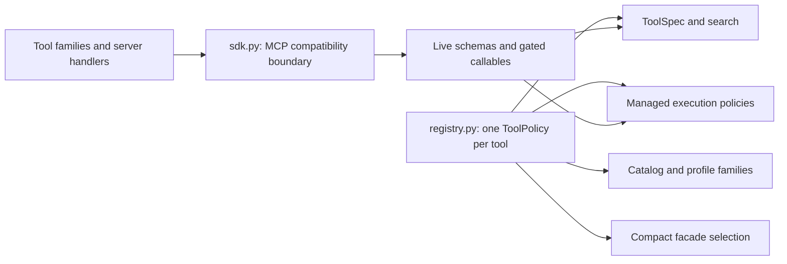

# Tool registry and registration boundaries

MoonMCP declares tool policies once in `moonmcp/registry.py`. The live registered
callable supplies its schema, description and scope/intrusive markers. Policy
metadata guides discovery and managed accounting; invocation still passes the
actual gates and the selected profile.

## Where to change code

| Module | Responsibility |
| --- | --- |
| `registry.py` | Tool family, aliases, conservative read-only metadata, reviewed request accounting, static cache eligibility, dependencies, compact/orientation membership and control restrictions |
| `catalog.py` | Profile family selectors and navigation text; catalog membership is derived from the registry |
| `toolspec.py` | Sanitized capabilities and descriptions combining policy metadata with actual registered schemas/gates |
| `execution.py` | Validation, receipts, budgeting, target/auth binding, cancellation and replay; policy sets are derived views |
| `sdk.py` | SDK manager/function-metadata access, native validation and conversion, profile removal and protocol adapter |
| `outcomes.py` | Versioned execution status, error classification, legacy text errors and exception guard; compatibility imports remain available |
| `families/knowledge.py` | Offline reference and signature lookup tools |
| `families/memory.py` | Shared memory and lessons |
| `families/runs.py` | Run/task/budget/artifact control tools |
| `families/reporting.py` | Findings, labels, scoring, exports and surface snapshots |
| `families/pipeline.py` | Existing local Hermes pipeline tools |
| `families/passive.py` | 15 OSINT, public research and reference handlers |
| `families/network.py` | 6 basic DNS/HTTP/TLS, header, fingerprint and well-known handlers |
| `families/infrastructure.py` | 7 backend, DNS, host routing, throttling, TLS, edge and raw HTTP handlers |
| `agent_tools.py` | Flags, hypotheses, managed dispatch and recovery tools |
| `server.py` | Composition, authorization wrappers, resources/prompts and remaining network families |

The eight extracted families contain 89 tool handlers. Their imports do not load
the server or construct application state. Each `register` binds the supplied
context getter to that server instance, so separate registrations do not share
their application context. Network registrations receive the context getter and
scope gates explicitly; imports never pull in `server.py`. Bind gates and clients
to the same context when composing an additional server. `server.py` re-exports the registered Python callables to
retain existing imports and internal composite calls.

All families register before profile filtering. Compact filtering controls
advertised schemas; the logical manager remains limited by the chosen profile.
Removal uses the SDK's public `remove_tool` operation. Private MCP manager and
function-metadata access belongs only in `sdk.py`; upgrading the SDK requires
reviewing that boundary and running the installed-wheel stdio smoke.

## Adding a tool

1. Add the handler to the appropriate family and register its real wrapper.
   Keep target authorization in the established gates or explicit self-scoped
   implementation; a policy entry never substitutes for them.
2. Add one `ToolPolicy` in `registry.py`. Catalog/profile membership, aliases,
   dependency diagnostics, managed policy views and compact membership are
   derived from this entry. Do not add another independent tool-name list.
3. Leave request accounting `unmetered` unless the implementation has been
   audited. Declaring a tool local or HTTP-accounted without verifying its
   nested transport would undermine run budgets. Browser/CLI/raw-protocol paths
   retain this default until their request reservation and cancellation exist.
4. Set static-reference eligibility only for immutable local reference data.
   Read-only operations on memory, findings or network state are not automatically
   cacheable. Unknown tools cannot acquire execution privileges from their name.
5. Run the registry/gates, affected family and protocol tests. The registry
   contract test catches a handler without policy or a policy without a handler.

Policies are frozen, and the policy mapping is immutable. Schemas are read from
live SDK tools instead of being copied into the registry. Profile-specific
discovery therefore does not restore hidden tools.

## Result compatibility and verification

Managed calls retain the existing `ok/state/error/data` envelope. Existing direct
tool payloads remain compatible, including text returned by pipeline tools.
Pipeline annotations now accurately say `str`; explicit unstructured registration
preserves their prior text content and absence of an output schema. New typed
output schemas still go through SDK validation. Every protocol result also exposes
[the versioned execution outcome](TOOL_OUTCOMES.md), including text errors and
validation failures. CLI clients can opt into the same envelope with `--envelope`.

Before extraction, the full public definitions and policy metadata were captured
from the running server. Comparison after refactoring found identical definitions
for all 231 tools, including descriptions, input and output schemas, and unchanged
family/read-only/idempotency/accounting/alias metadata. Ordering of `tools/list`
is not a contract. Real stdio tests cover full/compact profiles, hidden-tool
rejection, discovery, execution, replay and artifact retrieval.

Run `ruff check .`, `mypy moonmcp`, and the normal pytest coverage gate. Build a
wheel and run `python -I scripts/mcp_smoke.py` using the isolated environment
where that wheel is installed; the smoke rejects importing the source checkout.

Remaining work includes extracting the browser, scanner, web-probe and composite
network families, making swallowed partial failures explicit in legacy producers,
independent retrieval/investigation benchmarks, and metering additional transports. This refactor preserves the
current accounting boundary and does not claim those extensions are implemented.
